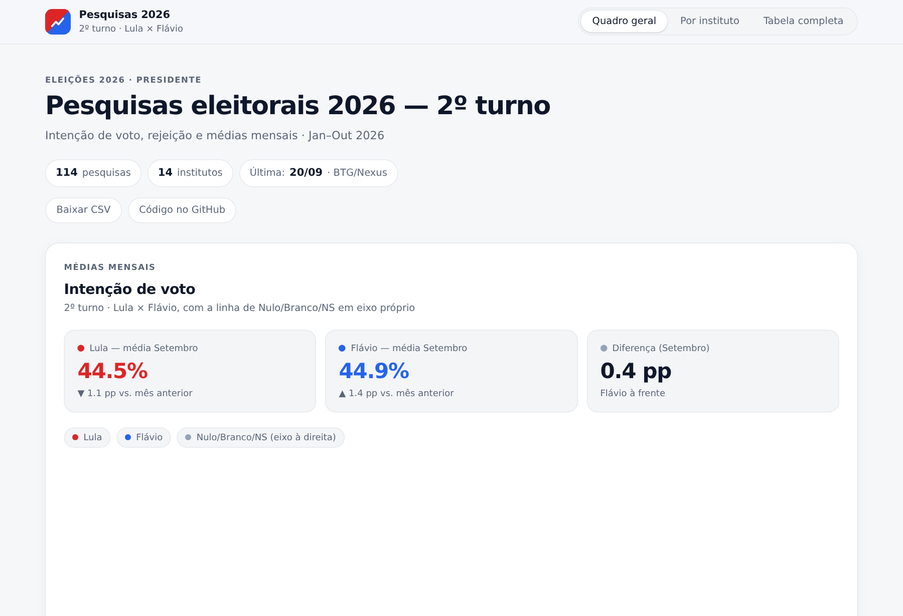

# Pesquisas eleitorais 2026 — 2º turno (Python)

[](https://github.com/SEU-USUARIO/pesquisas-eleitorais-2026-python/actions/workflows/ci.yml)
[](https://github.com/SEU-USUARIO/pesquisas-eleitorais-2026-python/actions/workflows/deploy.yml)
[](LICENSE)

Dashboard de pesquisas de intenção de voto e rejeição do **2º turno presidencial de 2026** (Lula × Flávio Bolsonaro). Os dados moram em **CSV**; todo cálculo e todo gráfico são feitos em **Python** (pandas + Plotly); o resultado é publicado como um site estático.

**[Ver o dashboard online →](https://SEU-USUARIO.github.io/pesquisas-eleitorais-2026-python/)**



## Por que este projeto

Peça de portfólio para demonstrar um fluxo de dados de ponta a ponta em Python: ingestão e validação de dados tabulares, cálculo estatístico, geração de gráficos, geração de site estático, testes automatizados, lint e CI/CD — sem depender de nenhum código de gráfico em JavaScript.

## Stack

| Camada | Ferramenta |
|---|---|
| Dados | CSV (`data/pesquisas.csv`) lido com **pandas** |
| Cálculos | **pandas** + **NumPy** (médias, arredondamento, regressão linear, médias móveis) |
| Gráficos | **Plotly** (`graph_objects`), 100% gerados em Python — o navegador só reidrata o JSON da figura |
| Página | **Jinja2** (HTML) + CSS; o JavaScript no navegador só troca de aba, aplica filtros e chama `Plotly.restyle/relayout` com configurações **já calculadas em Python** |
| CLI | `argparse` (`pesquisas build \| validar \| medias \| adicionar \| ordenar`) |
| Testes | **pytest** |
| Lint/format | **ruff** |
| CI/CD | **GitHub Actions** (testes em duas versões do Python + publicação automática no GitHub Pages) |

## Estrutura

```
├─ data/pesquisas.csv                  # fonte da verdade: 1 linha = 1 pesquisa
├─ src/pesquisas_eleitorais/
│  ├─ config.py       # institutos canônicos, meses, cores, caminhos
│  ├─ data.py         # leitura, validação e gravação do CSV
│  ├─ metrics.py       # médias, arredondamento, placar, tendência, eixos
│  ├─ charts.py        # as figuras Plotly (nenhum HTML aqui)
│  ├─ build.py          # monta o contexto e renderiza o template -> site/
│  ├─ cli.py            # `pesquisas build|validar|medias|adicionar|ordenar`
│  └─ templates/index.html.j2 + estilo.css
├─ tests/                # pytest (data.py e metrics.py)
├─ assets/screenshot.png
└─ .github/workflows/{ci,deploy}.yml
```

`site/` é gerado (`.gitignore`) — o workflow `deploy.yml` o recria a cada push em `main` e publica no Pages.

## Rodando localmente

```bash
python3 -m venv .venv && source .venv/bin/activate   # Windows: .venv\Scripts\activate
pip install -e ".[dev]"

pesquisas validar   # confere data/pesquisas.csv
pesquisas build      # gera site/index.html
python3 -m http.server 8000 --directory site   # http://localhost:8000
```

Ou, com o `Makefile`: `make install`, `make build`, `make serve`.

## CLI

```text
pesquisas validar                                 # confere nomes, datas, somas, duplicatas…
pesquisas medias                                  # imprime as médias mensais no terminal
pesquisas build [--saida DIR] [--offline]          # gera o site (--offline embute o Plotly.js)
pesquisas ordenar                                  # reordena o CSV por data
pesquisas adicionar --data AAAA-MM-DD --instituto NOME \
  --lula X --flavio Y --nulo Z --margem-erro E \
  [--rej-lula R --rej-flavio F]
```

`adicionar` aceita variações comuns de nome ("Quaest", "BTG/NEXUS"...) e converte para a forma canônica; se algum dado for inválido, nada é gravado.

## Testes e lint

```bash
pytest             # 36 casos: arredondamento, validação, placar, eixos dos gráficos…
ruff check .        # lint
ruff format .        # formatação
```

O CI roda os três a cada push/PR, em Python 3.10 e 3.12.

## Metodologia

- **Data da pesquisa:** último dia em que ela foi a campo (não a da publicação).
- **Outubro dividido em dois "meses":** por causa do 1º turno (04/10/2026), outubro aparece nas médias, no placar e na tabela completa como **"Out (até 1ºT)"** (dias 1 a 5) e **"Out (pós 1ºT)"** (dias 6 em diante) — tratados como dois meses totalmente separados, inclusive para a deduplicação por instituto abaixo. Ver `mes_da_data()` em `config.py`.
- **Médias mensais:** entra, no máximo, **uma pesquisa por instituto no mês — sempre a mais recente dele** — para que um instituto que publique várias pesquisas no mesmo mês não pese mais que os outros; institutos sem pesquisa naquele mês ficam de fora. Ignora quem não traz o dado (ex.: rejeição vazia). **Na rejeição, de cada instituto vale a pesquisa mais recente do período que tenha rejeição** (se a última dele não trouxe, usa-se a anterior do mesmo período que trouxe). Arredondamento **meio para cima** (46,95 → 47,0) — feito com `Decimal`, para não cair no arredondamento bancário do Python nem em erros de ponto flutuante.
- **Placar** (quantas pesquisas no mês dão vantagem a cada lado): usa todas as pesquisas do mês, sem essa deduplicação — é uma contagem de pesquisas, não uma média.
- **Vantagem:** só conta como "à frente" quando a diferença é maior que a margem de erro da própria pesquisa; caso contrário, empate técnico.
- **Soma 100%:** `lula + flavio + nulo` precisa fechar 100% (± 0,05 pp de tolerância).

## Como atualizar os dados

1. `pesquisas adicionar --data 2026-10-05 --instituto "Genial/Quaest" --lula 46 --flavio 44 --nulo 10 --margem-erro 2` (ou edite `data/pesquisas.csv` diretamente e rode `pesquisas ordenar` + `pesquisas validar`).
2. `git add . && git commit -m "dados: adiciona Genial/Quaest 05/10" && git push` — o CI valida e o Pages republica sozinho.

Ao entrar o primeiro mês novo (ex.: Outubro), nenhum ajuste manual de eixo é necessário: `metrics.py` calcula a faixa de cada gráfico a partir dos dados a cada execução.

## Fontes

<!-- Liste aqui de onde vêm os dados: institutos, veículos e o registro no TSE (PesqEle). -->
Resultados divulgados pelos institutos e pela imprensa; pesquisas registradas no TSE.

## Aviso

Projeto pessoal, sem vínculo com institutos, veículos ou campanhas. Pesquisas são retratos de um momento e têm margem de erro.

## Licença

Código sob licença MIT (veja `LICENSE`). Os dados pertencem aos respectivos institutos de pesquisa.
